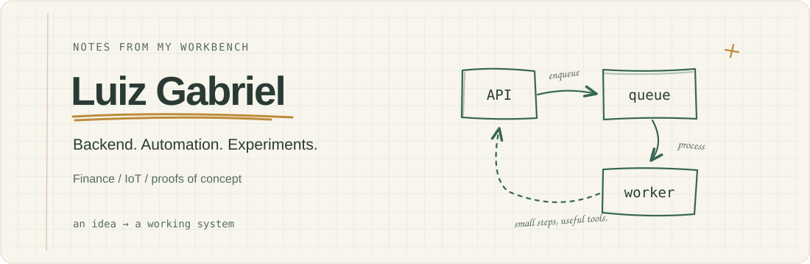
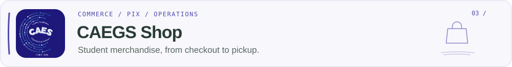
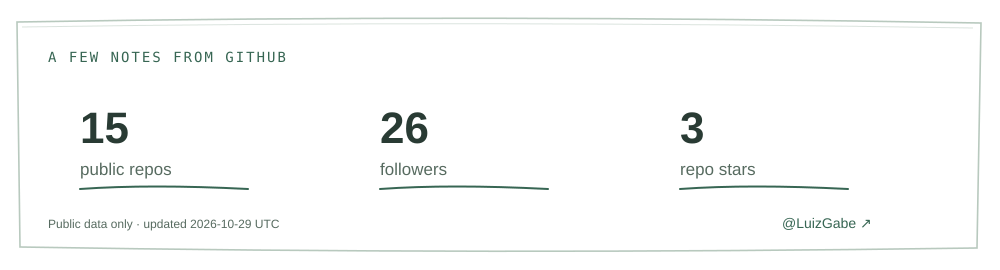

**English** · [Português](README.pt-BR.md)

  <picture>
    <source media="(prefers-color-scheme: dark)" srcset="assets/notebook-header-dark.svg">
    
  </picture>

I build backends and automations that turn ideas into useful tools. My interests span personal finance, IoT and proofs of concept — especially where services, data and devices meet.

I like following an idea through the whole system: the API, the background jobs, the integrations and the infrastructure that keeps it running.

### 01 / Selected projects

<a href="https://github.com/LuizGabe/Nebula">
  <picture>
    <source media="(prefers-color-scheme: dark)" srcset="assets/projects/nebula-dark-en.svg">
    
  </picture>
</a>

A platform for recording or uploading audio, transcribing it and generating documents with AI. Behind the interface, an asynchronous pipeline coordinates storage, transcription workers and document generation.

`TypeScript` · `Fastify` · `Python` · `PostgreSQL` · `Redis / BullMQ` · `MinIO`

<a href="https://github.com/LuizGabe/Aether">
  <picture>
    <source media="(prefers-color-scheme: dark)" srcset="assets/projects/aether-dark-en.svg">
    
  </picture>
</a>

A Windows desktop application for organizing accounts, cards, investments and transactions. It combines bank integrations through Pluggy with a local backend, SQLite storage and encrypted backup exports.

`Java 21` · `Spring Boot` · `SQLite` · `Tauri` · `React / TypeScript`

[Latest release / Windows installer →](https://github.com/LuizGabe/Aether/releases/latest)

<a href="https://github.com/LuizGabe/caegs-shop">
  <picture>
    <source media="(prefers-color-scheme: dark)" srcset="assets/projects/caegs-dark-en.svg">
    
  </picture>
</a>

A commerce platform for the Software Engineering Academic Center. It connects product sales to Asaas PIX payments and supports the work behind each order: payment webhooks, production batches and pickup management.

`TypeScript` · `Fastify` · `PostgreSQL` · `Prisma` · `Google OIDC` · `Asaas`

### 02 / What I work with

- **Backend systems:** APIs, authentication, data modeling and service integrations.
- **Automation:** background processing, queues and workflows that connect tools.
- **Finance:** transaction data, bank integrations and payment flows.
- **Experiments & IoT:** proofs of concept, connected devices and ideas worth testing.

Most of my recent work uses **TypeScript, Java and Python**, with **PostgreSQL, Redis and Docker** supporting the systems around them.

### 03 / Let's connect

Happy to exchange ideas about backend engineering, automation and useful experiments.

  &nbsp;
  &nbsp;
  

  <a href="https://github.com/LuizGabe?tab=repositories">
    <picture>
      <source media="(prefers-color-scheme: dark)" srcset="assets/profile-stats-dark.svg">
      
    </picture>
  </a>

